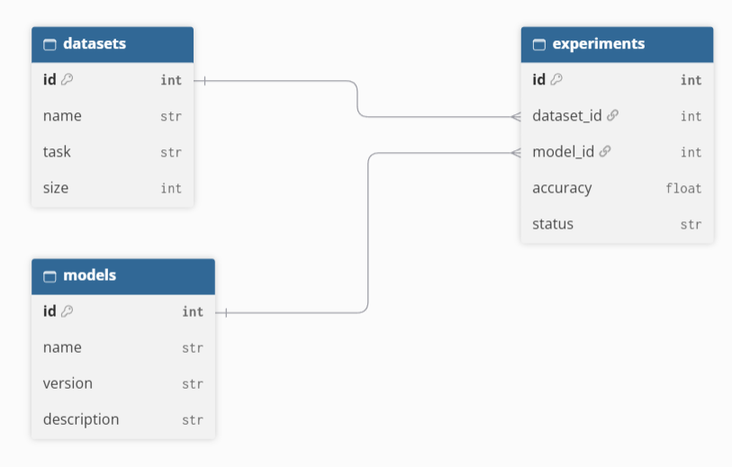

# MiniDB

мини-СУБД на Python для лабораторной. данные хранятся в обычных текстовых файлах, без использования готовых СУБД

## запуск

Нужен Python 3, ничего дополнительно устанавливать не надо

Запуск программы:

```
python minidb.py
```

При первом запуске нужно выбрать пункт 7, чтобы создать таблицы и добавить тестовые данные. пункт 9 нужен для создания большой таблицы, чтобы проверить скорость индекса

## файлы

- minidb.py — сама программа
- schema.txt — описание таблиц и их полей
- таблица.txt — данные таблиц
- таблица.idx — индекс для поиска по id
- backups/ — папка с резервными копиями
- benchmark.txt — результаты проверки скорости

## как хранятся данные

В schema.txt записано, какие есть таблицы, какие у них поля и внешние ключи

В файлах таблиц данные записываются построчно, значения разделяются символом ;, z.B.:

```
1;1;1;0.6;completed
```

Используются типы int, float и str. символ ; внутри текста использовать нельзя

В файле .idx хранится id записи и её offset. это позиция в байтах, с которой начинается запись в файле. Благодаря этому можно быстрее находить нужную запись



## что реализовано

- создание таблиц (create table)
- добавление, просмотр, изменение и удаление записей
- поиск по условиям, можно использовать AND и OR
- выбор нужных столбцов
- INNER JOIN для таблиц с экспериментами, моделями и датасетами
- автоматическая генерация id
- проверка типов и внешних ключей
- индекс для поиска по id
- проверка скорости поиска с индексом и без него
- резервное копирование и восстановление данных

если добавить эксперимент с несуществующим датасетом или моделью, программа выдаст ошибку. также нельзя удалить запись, на которую ссылаются другие записи

## результат замера индекса

Для проверки была создана таблица `big_experiments` на 10 000 записей. Выполнялось 1000 случайных поисков по id

| Способ | Время на запрос |
|---|---|
| Без индекса | 0.8198 мс |
| С индексом | 0.0439 мс |

получилось ускорение примерно в 18.7 раза. построение индекса заняло 7.2 мс

## ограничения

- нельзя использовать ; внутри строк
- индекс работает только по id
- при добавлении, изменении и удалении записей файл таблицы переписывается целиком

## Тесты

```
pip install pytest
python -m pytest -v
```

37 тестов. они проверяют типы, автоматические id, внешние ключи при добавлении, изменении и удалении, все операторы сравнения, AND/OR, JOIN, сохранность данных после перезапуска, создание таблиц, индекс (в том числе пересборку после удаления .idx), backup и restore (в том числе поврежденный архив). Тесты работают во временной папке и не трогают рабочие данные

## Docker

Сборка образа:

```
docker build -t minidb .
```

Данные хранятся в папке data рядом с проектом и остаются после удаления контейнера:

```
docker run -it --rm -v "${PWD}\data:/data" minidb
```

в пустой папке data начните с пункта 7

Тесты в контейнере:

```
docker run --rm minidb python -m pytest /app -q
```

## GUI

tkinter. Навайбкодил
